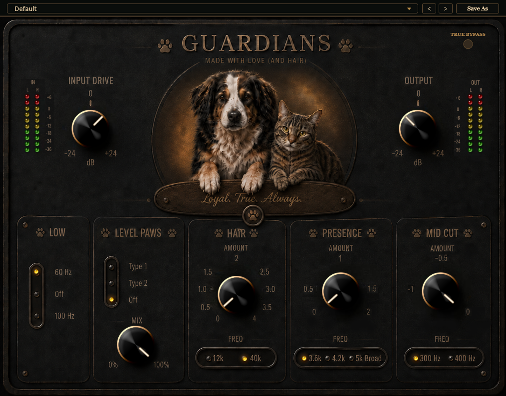

# Guardians Drum Bus

**Audio plugin for Windows and macOS**

## Download

| Platform | Formats | Installer |
| --- | --- | --- |
| Windows | VST3 · AAX | [**Download for Windows**](https://github.com/AntonioCalla27/Guardians-Drum-Bus/releases/latest/download/Guardians_Drum_Bus_Setup_1.0.0.exe) |
| macOS | VST3 · AU | [**Download for Mac**](https://github.com/AntonioCalla27/Guardians-Drum-Bus/releases/latest/download/Guardians_Drum_Bus_macOS_Local_Installer.pkg) |

Current release: **1.0.0**.

[Release page](https://github.com/AntonioCalla27/Guardians-Drum-Bus/releases/latest) · [Download checksums](https://github.com/AntonioCalla27/Guardians-Drum-Bus/releases/latest/download/SHA256SUMS.txt)

## Installation

1. Download the installer for your operating system.
2. Close your audio application and run the installer.
3. Reopen your audio application and rescan its plugins if needed.
4. Find **Guardians Drum Bus** in the plugin browser.

## MultiVerse Prod.

[Website](https://multiverseprod.netlify.app/) · [Plugins](https://multiverseprod.netlify.app/plugins.html)
